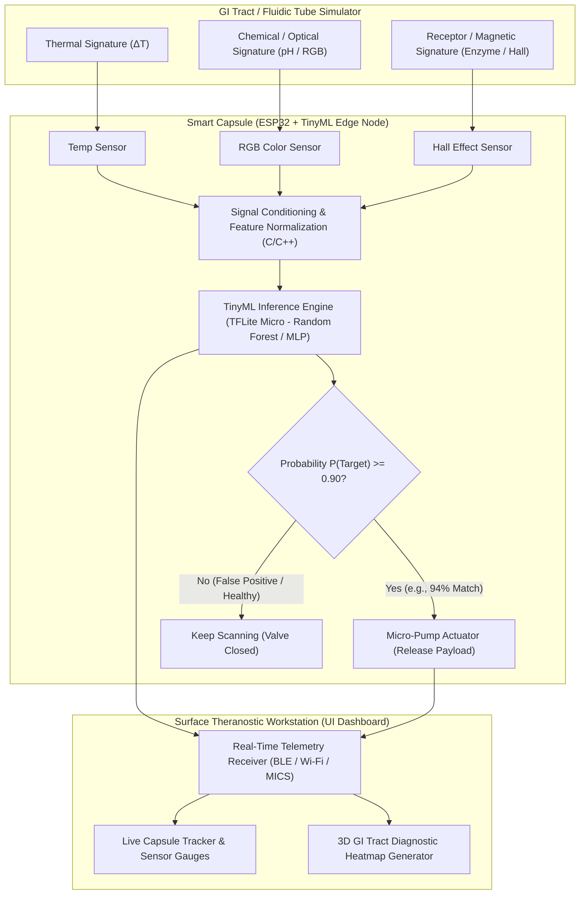

# 💊 BioTarget-AI: Autonomous Theranostic Smart Capsule for Targeted Drug Delivery

> **Domain:** Biomedical Embedded Systems, TinyML & Theranostics (Therapy + Diagnostics)  
> **Status:** System Architecture & Hardware-in-the-Loop (HIL) Prototype Specification

---

## 📌 1. Executive Summary & Problem Statement

### The Problem: Systemic Toxicity in Conventional Drug Delivery
When a patient ingests or receives conventional medication, the active pharmaceutical ingredient (API) circulates systemically through the bloodstream. Consequently:
1. **Off-Target Interaction:** The drug reacts with healthy tissues and organs, causing severe side effects (especially in chemotherapy and chronic inflammatory treatments).
2. **Low Bioavailability at Target:** Only a small fraction of the administered dose actually reaches the diseased lesion or target organ.

### The Proposed Solution: Autonomous Multi-Biomarker Theranostic Capsule
**BioTarget-AI** is an ingestible, closed-loop smart capsule architecture that traverses the gastrointestinal (GI) tract, continuously scanning the surrounding microenvironment. Instead of relying on passive time-delayed dissolution, the capsule executes an on-board **TinyML multi-sensor fusion model** to identify the exact **Bio-Signature** of the diseased tissue before triggering a micro-actuator to release its therapeutic payload. Simultaneously, it logs spatial telemetry to generate a 3D diagnostic heatmap of the GI tract.

---

## 🧬 2. Biomedical Reality vs. Lab Prototype (Hardware PoC) Mapping

To validate the engineering architecture safely in a laboratory setting without requiring clinical trials, the physical prototype maps biological disease markers to non-invasive electronic sensors inside a transparent fluidic GI-tract simulator:

| Aspect | Clinical / Biomedical Reality | Laboratory Hardware PoC (Simulation) |
| :--- | :--- | :--- |
| **Encapsulation & Safety** | Biocompatible medical-grade polymer shell (similar to FDA-approved *PillCam*); future iterations leverage **DNA Logic Gates**. | 3D-printed miniature shell coated in waterproof medical-grade **Epoxy Resin** housing the MCU and sensors. |
| **Marker 1: Chemical (pH)** | Tumorous or inflamed tissues exhibit localized acidosis (lower pH compared to healthy tissue). | **RGB Color Sensor** detecting calibrated chromatic shifts / optical markers along the inflamed tube segment. |
| **Marker 2: Thermal ($\Delta T$)** | Localized inflammation increases tissue temperature by fractions of a degree Celsius. | **High-Precision Digital Temperature Sensor** detecting a localized micro-heater embedded at the target zone. |
| **Marker 3: Enzymatic / Protein** | Disease-specific surface proteins/enzymes act as a molecular lock absent in healthy cells. | **Hall-Effect Magnetic Sensor** detecting a localized neodymium micro-magnet representing the target receptor lock. |
| **Wireless Telemetry** | **MICS** (*Medical Implant Communication Service*, 402–405 MHz) for safe human tissue penetration. | **ESP32 Wi-Fi / BLE** streaming real-time packets to the surface monitoring station. |
| **Payload Actuation** | Micro-electromechanical (MEMS) valve or electro-thermal membrane release. | **Micro-Peristaltic / Piezo Pump** injecting a high-contrast colored dye into the target zone. |

---

## 🏗️ 3. System Architecture & Data Flow

---

## 🧠 4. Multi-Sensor Fusion & TinyML Decision Logic

### Why Single-Sensor Thresholding Fails
Relying on a single biomarker creates dangerous false positives. For instance, if the capsule triggered solely on elevated temperature ($\Delta T$), a patient experiencing a systemic fever would cause premature drug release in healthy organs.

### Probabilistic TinyML Inference on the Edge
Furthermore, RF signals attenuate heavily through human tissue and water, making cloud-dependent decision-making unsafe due to latency and packet loss. **BioTarget-AI** runs a quantized **Random Forest / Lightweight Neural Network** directly on the **ESP32** using **TensorFlow Lite for Microcontrollers (TinyML)**:

1. **Input Feature Vector ($X$):**
   $$X = [\Delta T_{\text{norm}}, R_{\text{ratio}}, G_{\text{ratio}}, B_{\text{ratio}}, B_{\text{mag}}]$$
2. **Model Output:**
   Instead of a rigid binary flag, the model outputs a continuous probability distribution over tissue states:
   - `Healthy_Tissue`: $0.04$
   - `Systemic_Noise_Fever`: $0.02$
   - `Target_Inflammation`: **$0.94$ (94% Confidence)**
3. **Actuation Gate:**
   The micro-pump triggers **if and only if** $P(\text{Target\_Inflammation}) \ge 0.90$ across $N=3$ consecutive sampling windows (debouncing transient sensor noise).

---

## 🖥️ 5. Theranostic Surface Dashboard (UI Specification)

Because the capsule continuously samples the GI tract from ingestion to excretion, it acts as both a **Therapeutic** and **Diagnostic** (**Theranostic**) device. The surface dashboard provides:
- **Live Capsule State Monitor:** Displays current operating mode (`SCANNING`, `EVALUATING_ANOMALY`, `TARGET_DETECTED`, `PAYLOAD_DEPLOYED`).
- **Real-Time Multi-Sensor Telemetry:** Synchronized time-series graphs for Temperature, pH/Chromaticity, and Receptor/Magnetic flux.
- **Post-Journey Diagnostic Heatmap:** Reconstructs a color-coded spatial heatmap of the entire tubular path, allowing physicians to pinpoint secondary sub-threshold inflammation zones even where the drug was not deployed.

---

## 🛠️ 6. Implementation Roadmap (PoC Phases)

- **Phase 1 — Synthetic Dataset & Model Training:** Simulate healthy vs. inflamed sensor readings (including fever/noise edge cases) and train a compact classifier in Python (`Scikit-Learn` / `TensorFlow`).
- **Phase 2 — TinyML Quantization & Embedded C++ Port:** Convert the trained model into a C byte array (`.h` file) and deploy it onto the ESP32 alongside sensor polling routines.
- **Phase 3 — Fluidic Testbed Construction:** Assemble the transparent tubular track with a localized heating element, optical marker, and micro-magnet.
- **Phase 4 — Real-Time Theranostic UI:** Build the desktop monitoring dashboard (`C#` / `Python`) to visualize live telemetry, anomaly probabilities, and the spatial heatmap.
