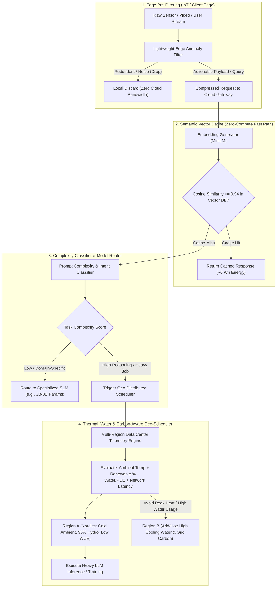

# 🌱 EcoRoute-AI: Sustainable & Carbon-Aware Distributed AI Inference Orchestrator

> **Domain:** Distributed Systems, Cloud Infrastructure, Green AI & Edge-to-Cloud Orchestration  
> **Status:** System Architecture & Algorithmic Routing Specification

---

## 📌 1. Executive Summary & Problem Statement

### The Problem: The Unsustainable Resource Footprint of Modern AI
Large-scale AI inference and training workloads rely on hyperscale data centers that consume massive amounts of electrical power and millions of gallons of freshwater for thermal cooling. Currently, standard AI gateways suffer from three major architectural inefficiencies:
1. **Model Over-Provisioning:** Simple queries (e.g., basic summarization, formatting, or FAQ lookup) are routinely routed to frontier Large Language Models (LLMs) with hundreds of billions of parameters when a lightweight Small Language Model (SLM) could achieve identical accuracy at a fraction of the compute cost.
2. **Redundant Recomputation:** Identical or semantically equivalent prompts are recomputed from scratch millions of times per day instead of leveraging semantic caching.
3. **Environment-Blind Scheduling:** Heavy batch and asynchronous AI workloads are dispatched to data centers without considering local ambient temperatures, water-cooling overhead (WUE), Power Usage Effectiveness (PUE), or real-time renewable energy availability.

### The Proposed Solution: A 4-Tier Green AI Gateway & Geo-Scheduler
**EcoRoute-AI** is an intelligent middleware and distributed orchestration layer placed between client edge devices and multi-region AI data centers. It minimizes energy and water consumption across four sequential filtering and routing stages—**Edge Pre-Filtering**, **Semantic Vector Caching**, **Complexity-Based SLM/LLM Routing**, and **Thermal/Carbon-Aware Geo-Load Balancing**—without degrading response quality or SLA latency targets.

---

## 🏗️ 2. Four-Stage System Architecture

---

## 🧠 3. Deep-Dive: The 4 Optimization Layers

### Layer 1: Intelligent Edge Pre-Filtering (Bandwidth & Compute Reduction)
Before data ever reaches the central cloud, edge nodes (smart cameras, industrial IoT gateways, or client devices) run a micro-heuristic/TinyML filter that evaluates **Information Entropy and Salience**:
- Static video frames, normal sensor heartbeats, and uninformative noise are filtered out locally.
- Only high-priority anomalies or queries requiring semantic analysis are transmitted upstream, drastically cutting network energy and cloud ingestion load.

### Layer 2: Semantic Vector Caching (Near-Zero Energy Lookups)
Before invoking any generative model, incoming prompts are converted into dense vector embeddings ($v \in \mathbb{R}^{384}$) and queried against a high-speed **Vector Database** (e.g., Qdrant / Milvus / Redis Vector):
$$\text{Similarity}(u, v) = \frac{u \cdot v}{\Vert{}u\Vert{} \Vert{}v\Vert{}}$$
- If a semantically equivalent question exists with $\text{Similarity}(u, v) \ge \tau$ (where $\tau = 0.94$), the verified response is returned immediately in $<15\text{ ms}$.
- **Impact:** Eliminates GPU inference entirely for recurring queries, reducing per-request energy consumption by $>99\%$.

### Layer 3: Dynamic SLM vs. LLM Complexity Routing
When a cache miss occurs, a lightweight BERT-based **Router Classifier** analyzes the prompt's syntactic structure, token length, and reasoning depth:
- **Fast Tier (SLMs — e.g., Phi-3, Llama-3-8B, Mistral-7B):** Handles classification, extraction, translation, and straightforward Q&A using $10\times$–$30\times$ less power than frontier models.
- **Frontier Tier (Heavy LLMs):** Reserved strictly for multi-step mathematical reasoning, complex code synthesis, and deep analytical tasks.

### Layer 4: Thermal, Water & Renewable-Aware Geo-Load Balancing
For heavy LLM inference or long-running asynchronous jobs, the **EcoRoute Geo-Scheduler** queries real-time telemetry across global data center regions and computes a composite **Green Routing Cost ($C_i$)** for each Data Center $i$:

$$C_i = w_1 \cdot \text{CarbonIntensity}_i + w_2 \cdot \text{ThermalCoolingLoad}(T_{\text{ambient}, i}) + w_3 \cdot \text{WaterUsage}(WUE_i) + w_4 \cdot \text{Latency}_i$$

- **Thermal & Water Optimization:** Data centers currently experiencing cooler ambient temperatures (e.g., nighttime regions or northern climates) require free-air cooling rather than evaporative water chilling.
- **Renewable Matching:** Workloads are dynamically shifted toward regions with peak solar/wind/hydro generation and away from coal/gas-heavy grids while respecting network latency constraints.

---

## 📊 4. Comparative Architectural Impact

| Metric / Dimension | Traditional Cloud AI Gateway | EcoRoute-AI Architecture |
| :--- | :--- | :--- |
| **Repeated / Similar Queries** | Full GPU recomputation every time | **Instant Vector DB Cache Hit (~0 GPU power)** |
| **Simple Tasks (70% of traffic)** | Routed to massive 100B+ LLM | **Routed to specialized 3B–8B SLM** |
| **Data Center Selection** | Nearest geographical IP only | **Multi-objective: Renewable %, Ambient Temp, Water (WUE) & Latency** |
| **Raw Edge Data Streams** | Streams 100% of raw data to cloud | **Filters noise at the Edge; transmits only high-value events** |

---

## 🛠️ 5. Proposed Tech Stack & PoC Implementation Plan

- **Edge Layer:** `Python` / `C++` lightweight stream filter simulating IoT/Camera telemetry pruning.
- **Semantic Cache Layer:** `Sentence-Transformers (all-MiniLM-L6-v2)` + `FAISS` / `Qdrant` Vector Database.
- **Model Router:** Fast binary/multi-class complexity scorer routing between a local SLM (`Ollama` / `Llama-3-8B`) and a Frontier LLM API.
- **Geo-Scheduler Simulator:** A `C#` or `Python` dashboard simulating 5 global data center nodes with live weather APIs (ambient temperature), grid carbon intensity APIs, and network latency metrics to visualize real-time green workload routing.
