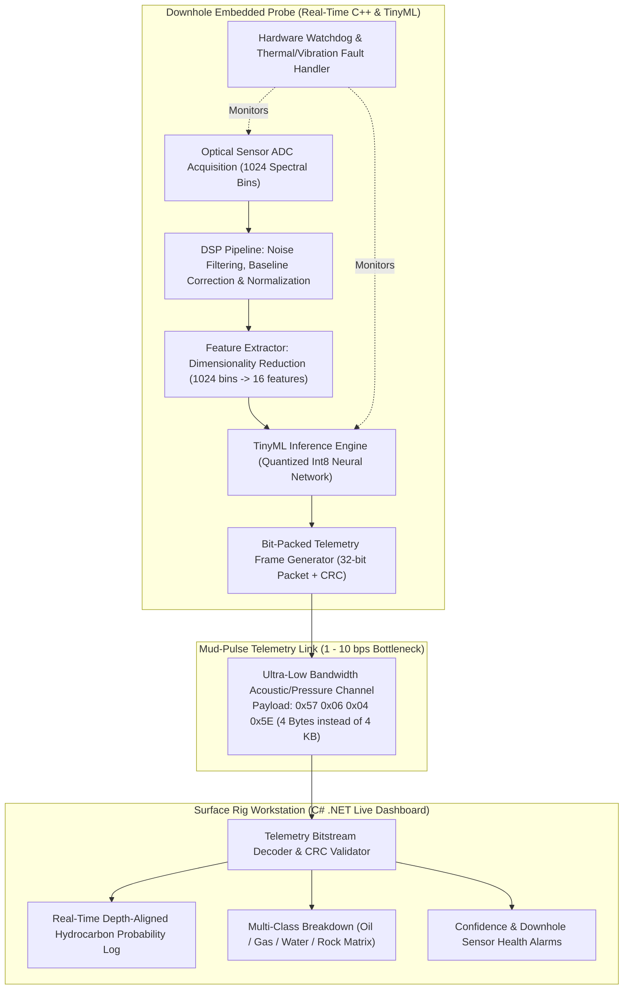

# 🛢️ OptiLog-LWD: Edge-AI Assisted Downhole Optical Spectroscopy for Real-Time Hydrocarbon Evaluation

> **Domain:** Industrial Embedded Systems (`C++`), Harsh-Environment Edge AI (`TinyML`), Signal Processing & Petroleum Telemetry (`C#`)  
> **Status:** Research & Engineering System Architecture Blueprint

---

## 📌 1. Executive Summary & Engineering Problem Statement

### The Problem: The Mud-Pulse Telemetry Bottleneck & Radioactive Source Risks in LWD
During drilling operations (**Logging-While-Drilling / LWD**), engineers need real-time subsurface formation evaluation to identify hydrocarbon zones (oil/gas vs. water/rock) and steer the drill bit accurately. However, two major engineering constraints exist:
1. **Extremely Low Telemetry Bandwidth:** Downhole tools communicate with the surface primarily via **Mud-Pulse Telemetry** (pressure waves sent through the drilling fluid column). This channel typically operates at **1 to 10 bits per second (bps)** (occasionally reaching a few dozen bps under ideal conditions). Transmitting high-resolution raw sensor spectra (thousands of floating-point values) in real time is physically impossible.
2. **Reliance on Chemical Radioactive Sources:** Traditional density and porosity logging often utilizes chemical radioactive sources (e.g., AmBe or Cs-137), introducing strict regulatory, environmental, and operational safety hazards if a tool becomes stuck downhole.

### The Proposed Solution: Downhole Optical Spectroscopy + TinyML Compression
**OptiLog-LWD** proposes a compact, sourceless optical formation evaluation architecture designed to complement modern LWD suites. Instead of transmitting raw spectral arrays to the surface, the downhole tool performs **active optical/spectroscopic excitation**, applies **C++ Digital Signal Processing (DSP)** to compensate for harsh drilling mud interference, and runs an on-board **TinyML multi-class classifier**. The entire 1024-point spectral signature is distilled into a **compact 32-bit probabilistic telemetry packet** capable of reaching the surface C# dashboard within seconds over a 1–10 bps mud-pulse link.

---

## 🔬 2. Scientific Realism & Harsh-Environment Mitigation

Subsurface boreholes are extreme environments characterized by high pressure/temperature (HPHT), intense mechanical vibration, and opaque drilling mud that scatters light. Rather than claiming simplistic direct UV imaging, **OptiLog-LWD** is engineered around a realistic **Spectroscopic Signal Chain**:

```mermaid
flowchart LR
    A["Subsurface Formation & Fluid"] --> B["Multi-Wavelength Optical Excitation (UV / Near-IR)"]
    B --> C["Photodetector Array (Raw Spectral Response)"]
    C --> D["C++ DSP: Mud Baseline Subtraction & Savitzky-Golay Filtering"]
    D --> E["Spectral Feature Extraction (Peak Ratios, Slopes, Band Integrals)"]
    E --> F["TinyML Classifier (Multi-Class Probability + Confidence)"]
    F --> G["32-Bit Frame Encoder (1-10 bps Mud-Pulse Telemetry)"]
    G --> H["Surface C# Real-Time Drilling Dashboard"]
```



### Handling Downhole Optical Challenges:
- **Drilling Mud Scattering & Absorption:** An internal reference photodetector continuously samples the drilling fluid baseline, allowing the C++ DSP pipeline to perform real-time **Dark-Current & Mud-Baseline Subtraction**.
- **Mineral & Additive Interference:** Instead of binary thresholding on a single wavelength, the system extracts multi-band spectral ratios (fluorescence decay + near-infrared absorption peaks) to separate hydrocarbon signatures from carbonate/mineral background fluorescence.
- **Probabilistic Output over Binary Claims:** Because downhole sensor uncertainty is unavoidable, the model outputs calibrated class probabilities and a sensor-health confidence score rather than a rigid `1 = Oil / 0 = Water` flag.

---

## 🏗️ 3. Dual-Tier Software Architecture (`Downhole C++` + `Surface C#`)



---

## 📡 4. Telemetry Compression Math (The Core Engineering Value)

To demonstrate why **Edge AI** is indispensable in downhole logging, compare the transmission time of raw spectral data versus **OptiLog-LWD** decision packets over a standard **4 bps** mud-pulse link:

1. **Raw Spectrum Transmission (Without Edge AI):**
   - $1024 \text{ spectral channels} \times 16 \text{ bits/channel} = 16,384 \text{ bits}$.
   - Transmission time at $4\text{ bps}$:
     $$t_{\text{raw}} = \frac{16,384\text{ bits}}{4\text{ bps}} = 4,096\text{ seconds} \approx \mathbf{68.2\text{ minutes per single reading!}}$$
   - By the time the spectrum arrives at the surface, the drill bit has already advanced tens of feet blindly.

2. **OptiLog-LWD Edge-AI Compressed Packet (With Downhole TinyML):**
   - The C++ TinyML engine evaluates the spectrum locally in $<25\text{ ms}$ and packs the probability distribution into a **32-bit (4-Byte) frame**:
     - `Byte 0`: Oil Likelihood ($0\text{–}100\%$, e.g., `87%` $\rightarrow$ `0x57`)
     - `Byte 1`: Gas Likelihood ($0\text{–}100\%$, e.g., `6%` $\rightarrow$ `0x06`)
     - `Byte 2`: Water/Rock Remainder & Sensor Confidence (`94%` $\rightarrow$ `0x5E`)
     - `Byte 3`: Status Flags + 4-bit CRC Checksum
   - Transmission time at $4\text{ bps}$:
     $$t_{\text{edge}} = \frac{32\text{ bits}}{4\text{ bps}} = \mathbf{8\text{ seconds!}}$$
   - **Result:** A **$512\times$ reduction in telemetry bandwidth**, enabling true real-time formation evaluation during active drilling.

---

## 📊 5. Probabilistic Classifier Output Specification

Instead of fragile binary classification, the downhole TinyML model outputs a normalized Softmax probability vector alongside a spectral quality confidence metric:

```text
=========================================================
 DOWNHOLE TELEMETRY FRAME DECODED — DEPTH: 2,485.5 m
=========================================================
 Classification Probabilities:
   - Crude Oil Signature : 0.87 (87%)
   - Natural Gas         : 0.06 ( 6%)
   - Formation Water     : 0.04 ( 4%)
   - Host Rock / Mud     : 0.03 ( 3%)
---------------------------------------------------------
 Spectral SNR Confidence : 94% (HIGH)
 Telemetry Frame (Hex)   : [0x57] [0x06] [0x5E] [0xA4]
 Tool Status             : NOMINAL (Temp: 112°C, Vib: OK)
=========================================================
```

---

## 🛠️ 6. 8-Phase Engineering & Lab Prototype Roadmap

- **Phase 1 — Lab Optical Signature Validation:** Test UV/NIR excitation and photodetector response across controlled lab samples (mineral oil, saline water, rock cuttings, and simulated drilling mud).
- **Phase 2 — Spectral Dataset Curation:** Collect multi-channel optical readings under varying turbidity and temperature levels.
- **Phase 3 — Multi-Class ML Training:** Train and validate a probabilistic classifier (`Oil`, `Gas`, `Water`, `Rock/Mud`) with uncertainty estimation.
- **Phase 4 — Embedded C++ & TinyML Porting:** Implement the DSP baseline-correction routines and quantized `Int8` neural network in portable `C++`.
- **Phase 5 — Low-Bandwidth Telemetry Simulator:** Build a software/serial throttle simulating a noisy **1–10 bps** mud-pulse channel to benchmark packet latency vs. raw data transmission.
- **Phase 6 — Downhole Probe Prototype:** Package the optical emitter, photodetector, and MCU into a ruggedized cylindrical probe enclosure.
- **Phase 7 — Surface C# Monitoring Dashboard:** Develop a real-time **C# (.NET WinForms/WPF)** surface workstation displaying depth logs, probability curves, and telemetry health.
- **Phase 8 — End-to-End Hardware-in-the-Loop Testing:** Validate the full pipeline from optical sample excitation to 4-byte telemetry decoding on the C# dashboard.
